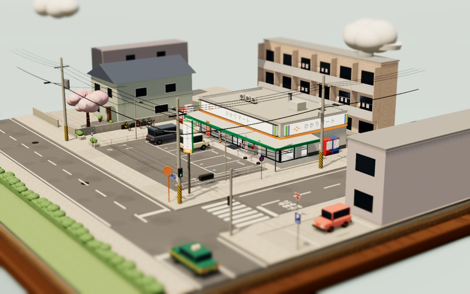

# Konbini

希望这家小便利店，能治愈你一天的疲惫。

**[在线体验 →](https://sandykidyao.github.io/konbini/)**


## 特点

- **时间与天气**：随意拖动时刻，切换晴、雨、雪、雾等八种天气；也可以打开「实况」，跟随你所在地此刻的天气
- **四季与节日**：春天樱花开，秋天叶子红；过年摆门松，圣诞节放圣诞树
- **街上的生活**：顾客进进出出，车来车往，送货车按时补货，后院长椅上睡着一只猫
- **俯视图**：换成从正上方看的一块像素风小图，车和人、红绿灯、天气和昼夜都跟模型同步，很省电，适合放在桌面一角

| | |
|---|---|
|  |  |
|  |  |

## 桌面版

把便利店放在桌面一角，像一个小摆件。目前只支持 Apple 芯片的 Mac：在 [Releases](https://github.com/SandyKidYao/konbini/releases/latest) 下载 `Konbini-…-arm64.dmg`，把 Konbini 拖进「应用程序」。

App 还没有经过 Apple 公证，第一次打开会被系统拦下：打开「系统设置 → 隐私与安全性」，在页面下方点「仍要打开」即可，之后就能正常打开。

把指针移到模型上，下方会出现设置按钮，天气、时刻、日期、视角都在这里，和网页版一样；拖动这个按钮可以挪动位置。想要更小、更省电，可以在设置里或菜单「形态」里换成俯视图，拖动俯视图本身也能挪动位置。平时它只在菜单栏留一个小店图标，右键模型或点这个图标可以调整大小、置顶和省电；也可以在菜单「显示图标」里让它出现在程序坞。

## 本地运行

```bash
npm install
npm run dev     # 打开 http://localhost:5173
npm run pet     # 桌宠（macOS）
```

## 参考

想给场景加点东西？参见 [模组扩展](docs/MODDING.md)。

## 隐私

不会收集或记录你的位置等个人信息。打开「实况」后，大致位置只会用于查询当地天气，结果只缓存在你自己的浏览器里。

## 致谢

- 感谢 [Susu 的视频](https://x.com/NFT_Chen/status/2109034305968336929) 提供的灵感
- 天气数据来自 [Open-Meteo](https://open-meteo.com)，地名来自 [BigDataCloud](https://www.bigdatacloud.com)
- 使用 [Three.js](https://threejs.org) 构建

## 许可

[MIT](LICENSE)
